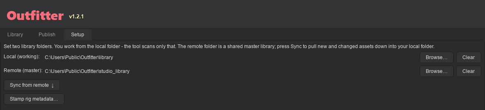
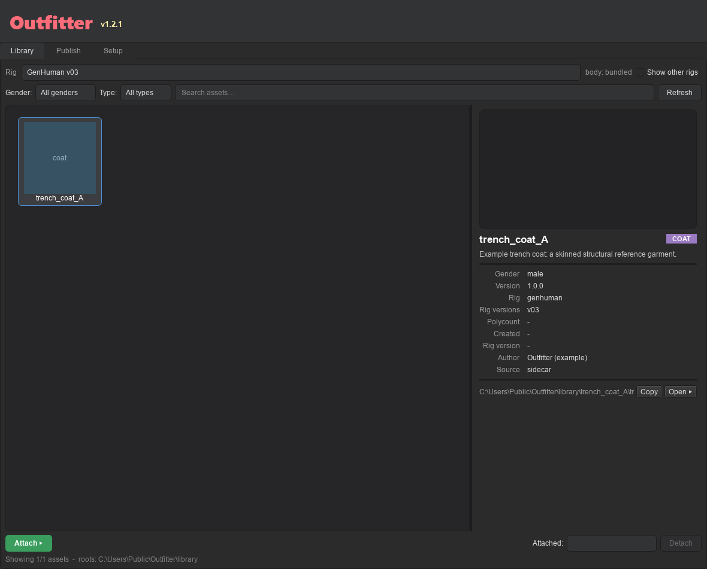
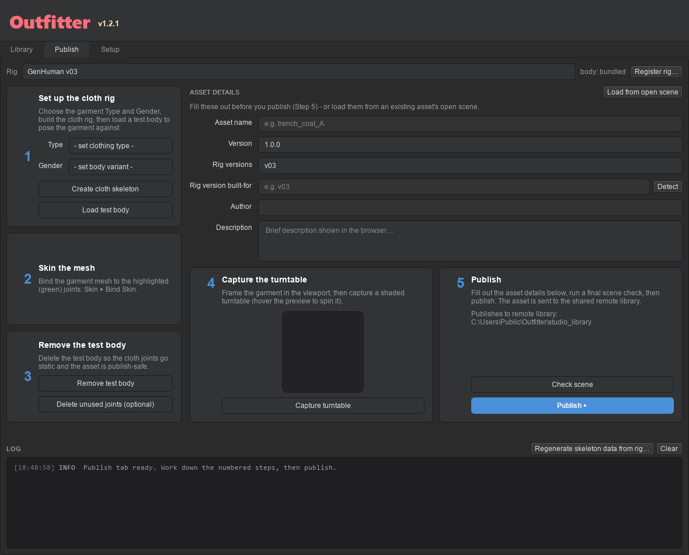
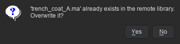

# Outfitter Guide

Outfitter is a Maya 2026 tool for dressing character rigs. Browse a shared library of
clothing, snap a garment onto your animated character in one click, and take it off just as
cleanly. Made something new? The tool walks you through publishing it back to the library
so everyone can use it.

It runs as a single window with three tabs: **Library** (browse and attach), **Publish**
(turn a garment you built into a library asset), and **Setup** (where your library lives).

**GenHuman v03** comes registered out of the box. Working with a different rig? Register it
once (see *Working with rigs*) and everything else behaves the same.

---

## 1. How it works

Every garment is a mesh skinned to its own copy of the rig's skeleton - the `cloth_*`
joints. Attaching does exactly one thing: it connects each body joint to the garment joint
with the matching name (`spine_03` drives `cloth_spine_03`), translate, rotate and scale.

- The match is **by name**. If something doesn't follow the body, check joint names first.
- **No constraints, utility nodes, expressions or driven keys** are ever created, and
  **the rig itself is never modified**. A dressed scene exports exactly as the bare rig
  would (see *Genie export*).
- You can wear several garments at once. Each one sits in its own namespace (e.g. `coat:`),
  and **Detach** removes only that garment and the connections the tool made.
- Helper joints you add to a garment (coat tails, skirts, straps) are not connected. They
  stay free for the animator.

---

## 2. Install and setup

### Install

1. Unzip the distribution somewhere, keeping its layout intact.
2. Drag `install.py` from a file browser into a Maya 2026 viewport.
3. Outfitter copies itself in, merges a starter set of assets into your library (without
   overwriting anything you already have), and adds an **Outfitter** button to the shelf
   you have open. A dialog confirms what it did.

Click that shelf button any time to open the window. You can also launch it from the
Script Editor (Python):

```python
import outfitter.launch
outfitter.launch.run()
```

Dropping `install.py` again later **upgrades** the tool. The package is replaced; your
assets and library folders are kept.

### Point it at your library (Setup tab)

On **Setup** you set two folders:

- **Local (working):** your copy of the library, on your machine or a fast drive. **This is
  the only folder Outfitter scans** - you browse and attach from here.
- **Remote (master):** the shared studio library on a server or network drive. It is never
  scanned. Publishing writes to it, and Sync pulls from it.

Use **Browse…** to pick each folder, or **Clear** to unset it. Both are saved in a small
text file, `path.txt`, beside the installed package. It survives upgrades, and you can edit
it by hand if you prefer:

```
local  = D:/clothing_library
remote = //studio-nas/projects/genhuman/clothing
```



With no local folder set, Outfitter falls back to its built-in library. No remote? Outfitter
runs happily on just the local folder (but you need one to publish). A folder shown as
**(missing)** isn't reachable right now, usually because the drive or server isn't mounted.

### Sync from the master library

Click **Sync from remote ↓** to pull the latest assets down into your local folder. Sync is
one-way, and apart from deleted assets it only ever adds and updates:

- New assets on the remote are copied down. Assets that changed on the remote (different
  size or newer) replace your local copy.
- Assets you made locally are **always kept**.
- A file you edited locally more recently than the remote copy is left alone.
- An asset someone deleted from the library (see [Delete a garment](#delete-a-garment)) is
  moved to your trash - unless you edited it after it was deleted, in which case it stays.

You get a one-line summary (e.g. *"Sync complete - 3 added, 1 updated, 12 up to date."*)
and the Library refreshes. The button is greyed out until both folders are set. The
**Refresh** button at the top of the window also pulls from the remote first.

---

## 3. Working with rigs

At the top of the **Library** and **Publish** tabs is a **Rig** dropdown. It answers "which
character am I working with?", and everything follows from it: the Library shows clothing
for that rig, and Publish tags what you make with it. Your choice is remembered between
sessions.

### Register a new rig

Put the rig in a scene, go to the **Publish** tab and click **Register rig…**. Outfitter
reads the scene and proposes:

- the **export skeleton** - the group holding the joints garments will bind to. It lists
  every candidate it found, biggest first. Pick the right one; this is the skeleton it
  captures.
- the **body variants** - the attribute that switches between male and female bodies, if
  the rig has one. Nothing in a rig says which end of the slider is which body, so if the
  two come out backwards, click **Swap**.
- the **rig file** - the `.ma` to copy into the shared library so colleagues can fetch it.
  Confirm it's the rig itself and not the scene you imported it into.

Click **Register**. Outfitter captures the skeleton, works out which joints each garment
type should skin to, saves the rig profile to the shared library, and selects the new rig.
Everyone else picks it up on their next **Sync**.

### Fetch a rig body

Rig files are big, so Sync doesn't copy them to every machine (it copies only the small rig
profiles). Beside the rig dropdown you'll see where the body is: *ready*, or *not
downloaded* with its size. It downloads when you first need it (loading a test body) or
when you click **Fetch rig**. Just picking a rig never downloads anything.

### Rigs and versions

Every asset records one **rig** (which rig it's built for) and the **rig versions** of that
rig it fits. Both are checked before attach. A garment for a different rig is refused
outright, because two rigs can share joint names and the garment would attach and then
deform into nonsense. If the scene's rig version can't be detected, the version check is
skipped with a warning instead of blocking you.

Assets published before Outfitter supported multiple rigs carry no rig ID; they're read as
GenHuman assets, so an older library keeps working. **Setup ▸ Stamp rig metadata…** writes
that identity into them explicitly.

### Use a garment on a different rig

A garment is skinned to one rig's skeleton, so it can't simply be attached to another.
Right-click it in the Library and choose **Retarget to…**. Outfitter opens the asset,
renames its joints to the new rig's, and moves them onto the new rest pose *without
disturbing your skin weights*. It shows you anything it couldn't map before it starts.

> Retargeting does not reshape the garment. If the two rigs are different sizes, the mesh
> needs a manual refit and probably a weight touch-up. Check the fit on the new body, then
> publish it under a new name - the original is left alone.

---

## 4. Dress a character (Library tab)

The **Library** tab shows your assets as a grid of thumbnails.



- Filter by **Gender** and **Type** (shoes, pants, shirt, dress, coat, hat), or use the
  **Search** box.
- Clothing built for other rigs is hidden. The status line at the bottom counts it, and
  **Show other rigs** brings it into view (greyed out, since it can't be attached here).
- Click an asset to see its details: name, type, version, rig and rig versions, author,
  path, and any problems. The preview is a live turntable - hover to spin it, or drag left
  and right.
- **Right-click** a thumbnail to open its folder, copy its path, refresh its thumbnails, or
  retarget it.

To dress your character:

1. Make sure the rig picked in the **Rig** dropdown is in your scene. Several rigs in
   there? Select any node of the one you mean first.
2. Select an asset and click **Attach ▸**. Give the instance a name if asked; it becomes
   the garment's namespace.
3. Outfitter checks everything first (see *Validation error reference*). If anything is an
   **error**, attach is refused and **the scene is left exactly as it was**. Warnings don't
   block.
4. The garment snaps on and follows as you pose and animate. Repeat for more garments,
   e.g. a shirt, pants and shoes together.
5. Done with one? Pick it in the **Attached** list and click **Detach**. The rest stay on.

### Male and female variants

There is no fit step when you attach. A rig's body morph moves only the body *mesh*, not
the joints, so a single garment can't follow the difference between the male and female
body on its own. Instead each garment is made twice, hand-fit once on the male body and
once on the female body, and those are two separate assets. Pick the variant that matches
the body you're dressing. A rig with a single body has no variants, and its assets record
gender `none`.

---

## 5. Make a garment (Publish tab)

**Make in:** Maya 2026 · **Save as:** Maya ASCII (`.ma`)

### What you're making

A clothing asset is your garment mesh, skinned to the rig's `cloth_*` joints, in a clean
scene. Outfitter builds the joints and the scene structure for you; your job is the mesh,
the skinning, and keeping the scene clean. Make each garment **twice** - once on the male
body, once on the female body. By convention they're named `m_<name>` and `f_<name>`.

### Prep the mesh

- **Pivot at world origin (on the ground), transforms frozen, geo at its correct height.**
  A non-zero pivot height is a handy sign the garment isn't sitting right on the rig.
- Clean **UVs** on every mesh. Name meshes `cloth_<part>_mesh`.
- **Smooth bind** only. **Delete history.**
- **Generic shader** (`lambert` or `standardSurface`).
- No blendShapes, no nCloth or simulation, no shrinkWrap to the body.

### Keep the scene clean

**Create cloth skeleton** (Step 1 below) makes the three required groups - **`Mesh_GRP`**
for meshes, **`Rig_GRP`** for the `cloth_*` joints, **`Ctrl_GRP`** for controls - and moves
your garment geo into `Mesh_GRP`. To publish, the scene also needs:

- **Bare names** - no namespaces, no references, no body rig left in the scene.
- Skin on the **`cloth_*` joints** only, never the body rig's joints.
- Extra controls (for tails, skirts, straps) in **`Ctrl_GRP`**.

If the body rig is already in the scene when you build, Outfitter can't tell your geo from
the body mesh, so it leaves `Mesh_GRP` empty for you to fill.

### Step by step

Work straight down the five numbered steps on the Publish tab.



**1. Set up the cloth rig.** Check the **Rig** dropdown is the rig you're building for,
pick the **Type** and **Gender**, then click **Create cloth skeleton**. Outfitter builds
the cloth joints, creates the groups, and turns the joints you should skin to **green**.
Click **Load test body** to bring in the matching body to pose against. (A rig with a
single body has no Gender to choose, and the field says so.)

**2. Skin the mesh.** Bind your garment to the green joints (**Skin ▸ Bind Skin**). A
standard smooth bind, nothing fancy.

**3. Remove the test body.** Pose the body to check your garment follows nicely, then click
**Remove test body** so the joints go still. (Optional: **Delete unused joints** to tidy
up.)

**4. Capture the turntable.** Frame your garment in the viewport and click **Capture
turntable**. Outfitter orbits it and bakes a clean, shaded preview, plus a still for the
grid thumbnail. Hover it to make sure it looks good.

**5. Publish.** Fill in the details (asset name, version, rig versions it fits, author,
description), click **Check scene** to catch problems, then click **Publish**. Outfitter
writes the details into the `.ma` (a `cloth_info` node) and sends the asset to the shared
library, ready for everyone. Publishing needs a remote folder set on the Setup tab.

### Final checklist

- [ ] Pivot at world origin, transforms frozen, geo at correct height; history deleted;
      clean UVs.
- [ ] `Mesh_GRP`, `Rig_GRP` and `Ctrl_GRP` at the root; bare names; no namespaces or
      references.
- [ ] Skinned to `cloth_*` joints (smooth bind). No blendShapes, simulation or shrinkWrap.
- [ ] Generic shader only.
- [ ] Test body removed - no body rig left in the scene.
- [ ] **Type** and **Gender** set; details filled in.
- [ ] **Check scene** passes.

---

## 6. Fix a garment you already published

Spotted a weighting mistake (or anything else) after publishing? Fix it and publish over
the top - the library keeps one copy per name, so there is nothing to delete first.

1. **Open the published `.ma`** from the shared library (`<library>/<name>/<name>.ma`). It
   re-opens fully editable: the mesh, the cloth joints, and the skin all survive.
2. **Fix it** - e.g. **Paint Skin Weights** on the existing skin. Keep the skin on the cloth
   joints; **Check scene** flags anything else. To pose-test, **Load test body**, then
   **Remove test body** before publishing.
3. On the Publish tab, click **Load from open scene**. The form fills itself from the
   details saved inside the asset.
4. **Keep the name exactly as it is** - that is what makes this an update. A new name
   publishes a second garment alongside the old one.
5. **Bump the version** (say `1.0.0` to `1.0.1`) so people can tell the fixed copy apart.
6. **Check scene**, then **Publish**, and answer **Yes** when it asks to overwrite.



Your weights are saved exactly as you painted them; nothing rebuilds the skin. The
thumbnail and turntable are regenerated. Two things to know afterwards:

- **Everyone else gets the fix on their next Sync** (or **Refresh**).
- **Scenes already wearing the old version keep the old weights.** Attaching copies the
  garment into the scene, so those scenes don't update on their own: **Detach** the garment
  and **Attach** it again from the library.

### Update just the thumbnails

Older assets keep whatever thumbnail they shipped with. To give one the shaded still and
spinnable turntable without a full re-publish, **right-click its thumbnail** and choose
**↻ Refresh thumbnails**. It opens the asset in Maya, recaptures, and overwrites only the
two image files - the `.ma` and its details are untouched. The images go to your local copy
and, when a remote library is set and already holds the asset, to the shared copy too. It
replaces the current Maya scene, so save your work first.

### Rename a garment

Right-click its thumbnail and choose **Rename…**, then type the new name. The name you type
is what the Library shows; the files and folder use a filesystem-safe version of it (spaces
become `_`, as when publishing).

- The asset is renamed in your local library and, when it has been published, in the shared
  one too. Each copy keeps its own content, so unpublished local edits stay local.
- **Everyone else sees the new name on their next Sync** (or **Refresh**); their copy under
  the old name goes to the trash, just as if it had been deleted (see below).
- The old files are moved to the trash, not destroyed.
- A name already used by another asset is refused - rename never overwrites anything.
- Only the name changes. The garment's nodes (including its `cloth_<name>` top group) are
  untouched, and scenes already wearing it don't change.

### Delete a garment

Right-click its thumbnail and choose **Delete…**. After you confirm:

- The asset is removed from your local library and, when a remote is set, from the shared
  one too.
- **Everyone else loses it on their next Sync** (or **Refresh**). Anyone who edited their
  copy after the delete keeps it.
- Nothing is destroyed. Each copy is moved to that library's `_rigs/_trash/` folder, named
  `<name>_<date>-<time>`. To undo, move the folder back into the library (the remote
  copy too) and delete the asset's marker from the remote's `_deleted/` folder.
- Scenes already wearing the garment don't change. **Detach** it there if you want it gone.

Only assets in your own local folder can be deleted, not the built-in starter library.
Publishing a garment under a deleted name brings it back for everyone.

---

## 7. Genie export

Attaching only connects transform channels and never adds nodes to or changes the rig, so
you **export the dressed scene normally** (`.ma`, USD, FBX or Alembic). Required rig node
names are preserved and the export skeleton is intact. An export-readiness check confirms,
before you export, that every connection Outfitter made drives the garment (never the rig)
and that the export skeleton still resolves.

> **Pending from the pipeline team:** the exact list of Genie-required node names. Until it
> arrives, that part of the check never blocks you.

---

## 8. Validation error reference

Outfitter validates in three stages. Any **error** is a hard stop and leaves the scene
unchanged; **warnings** are advisory. Each message names the node at fault and how to fix
it. If attach fails for any reason, the scene is rolled back - you never end up with a
half-attached garment.

### Stage A - the asset file (before anything touches the scene)

| Code | Meaning | Fix |
|---|---|---|
| `no_metadata` | No readable `cloth_info` or sidecar `.json`, or a required field (incl. `gender`) is missing or invalid. | Re-publish with all details filled in. |
| `no_info_node` | The `cloth_info` node is missing. | Re-publish from the Publish tab, which adds it. |
| `missing_group` | `Mesh_GRP`, `Rig_GRP` or `Ctrl_GRP` is missing. | Create the missing group under the asset's top group. |
| `no_root_joint` | No `cloth_root` joint. | Rebuild with **Create cloth skeleton**. |
| `no_cloth_joints` | No `cloth_` joints found. | Rebuild with **Create cloth skeleton**. |
| `bad_joint_suffix` | A connection joint has a `_jnt` suffix. | Name = `cloth_` + the exact body joint name, no `_jnt`. |
| `has_references` | The asset contains references. | Import or remove all references. |
| `has_namespaces` | The asset contains namespaces. | Remove them; Outfitter adds one at attach. |
| `forbidden_node_type` | A `blendShape`, `nCloth` or `nucleus` node is present. | Remove it; blendShapes and simulation aren't supported. |
| `duplicate_name` | A node name appears more than once. | Make every node name unique. |

### Stage B - the scene, just before import

| Code | Severity | Meaning | Fix |
|---|---|---|---|
| `no_rig` | error | The selected rig isn't in the scene. | Load that rig, or pick the rig that is in the scene. |
| `rig_mismatch` | error | The asset was built for a different rig. | Use an asset for this rig, or **Retarget to…** it. |
| `version_unknown` | warning | The scene's rig version couldn't be detected. | The version check is skipped, not failed. |
| `version_incompat` | error | The asset's rig versions don't include this scene's version. | Use an asset that covers this build of the rig. |
| `ns_in_use` / `ns_exists` | error | The instance name is already taken. | Choose a different instance name. |
| `genie_missing` | error | A Genie-required node is missing. | Make sure the export-required node exists (see *Genie export*). |

### Stage C - connecting joints (during attach; rolls back automatically)

| Code | Meaning |
|---|---|
| `no_joint_match` | No `cloth_*` joint matched a body joint (check exact names). |
| `cloth_joint_missing` | A matched joint wasn't found after import. |
| `attr_missing` / `attr_locked` / `attr_connected` | A translate, rotate or scale channel is missing, locked, or already driven. Unlock or free it first. |
| `no_body_joints` / `ambiguous_body_joint` | The export skeleton has no joints, or a joint name is ambiguous within it. |
| `import_failed` / `attach_failed` | Maya couldn't import the asset or make a connection; the scene was rolled back. |

---

## 9. Troubleshooting

| Symptom | Likely cause / fix |
|---|---|
| Asset shows as **invalid** in the browser | Open its details - the issues list names the validation codes (section 8). Usually missing details or a missing group. |
| Attach says **rig not found** | The rig picked in the **Rig** dropdown isn't in the scene. Load it, or switch to the rig that is. |
| Attach says the asset is **built for another rig** | A garment fits one rig only. Switch rigs, or right-click it and **Retarget to…** (then check the fit). |
| An asset **vanished** from the browser | It's built for another rig. Tick **Show other rigs**. |
| Attach says **no_joint_match** | A `cloth_*` joint name doesn't exactly match a body joint (case, `_l`/`_r`, no `_jnt`). |
| Garment doesn't follow the body | The joints didn't connect - check names, and confirm the garment was attached with **Attach**, not just imported. |
| A fixed garment still has the **old weights** | The scene keeps the copy it was dressed with. **Sync** (or **Refresh**), then **Detach** and **Attach** it again. |
| Garment fits the wrong body | Attach the variant (male or female) that matches the body you're dressing (section 4). |
| **Publish** says no remote library is set | Set the **Remote** folder on the Setup tab. |
| Library is empty | Set your **Local** folder on Setup to where your assets live, or **Sync from remote**. |
| A folder shows **(missing)** | The drive or server isn't mounted. Reconnect it, or pick a reachable folder. |
| **Sync** button is greyed out | Set both a **Local** and a **Remote** folder on Setup. |
| Sync reports failures | The remote isn't reachable, or some files are locked; the summary gives the count, and everything it could copy still came down. |
